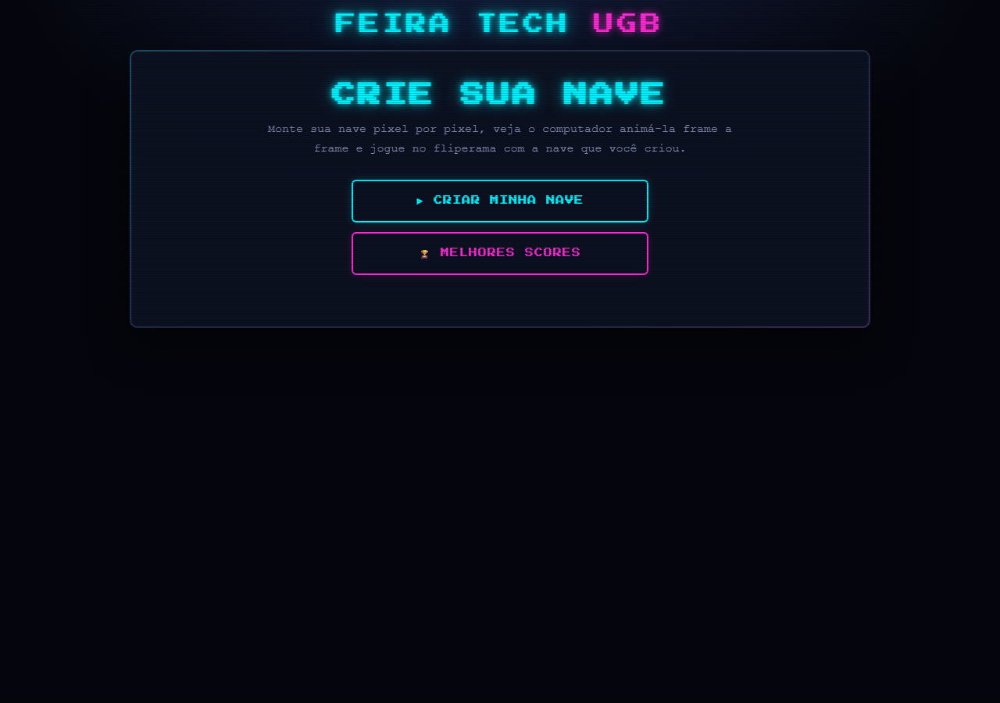
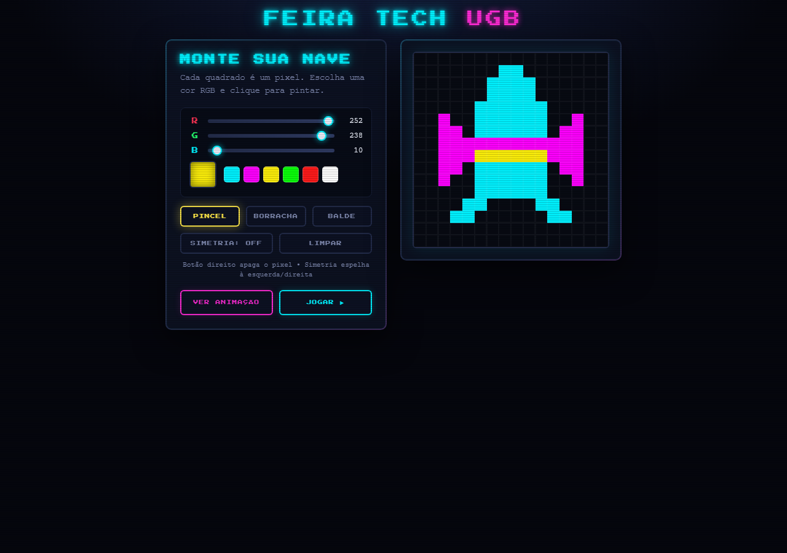
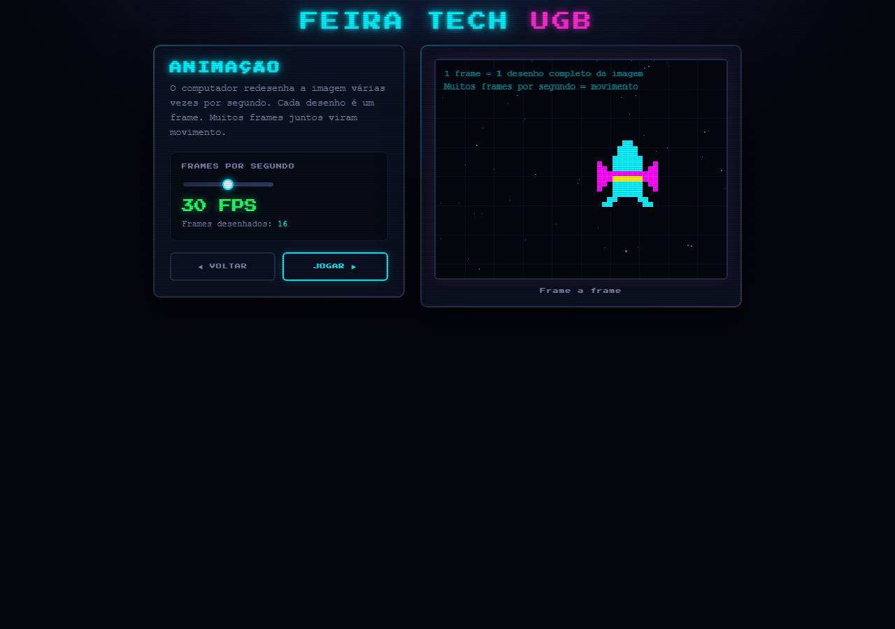
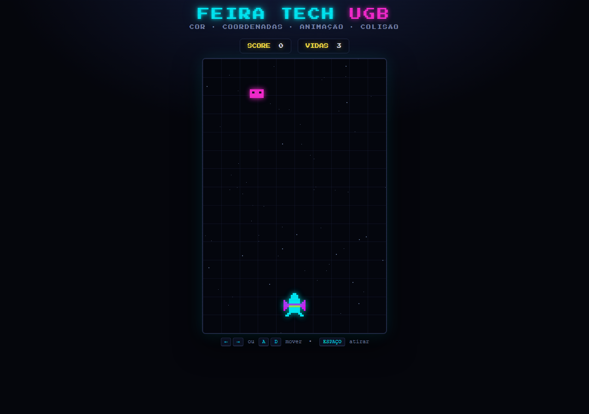
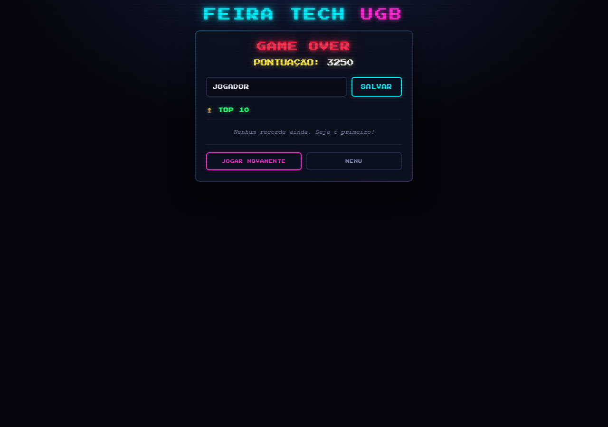
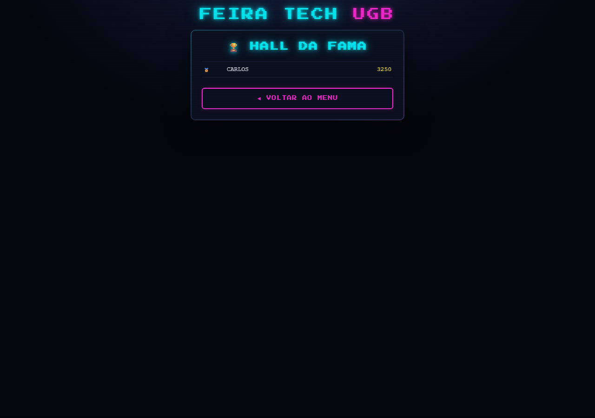

<div align="center">

# 🚀 Feira Tech UGB — Crie Sua Nave

**Um fliperama educativo que ensina, na prática, como o computador cria e anima imagens.**

[](https://developer.mozilla.org/pt-BR/docs/Web/HTML)
[](https://developer.mozilla.org/pt-BR/docs/Web/CSS)
[](https://developer.mozilla.org/pt-BR/docs/Web/JavaScript)
[](https://developer.mozilla.org/pt-BR/docs/Web/API/Canvas_API)
[](LICENSE)
[](https://ohcarlos.github.io/feira-tech-ugb/)

</div>

---

## 📖 Sobre o projeto

Este projeto nasceu para um estande da **Feira Tech UGB**. A proposta é mostrar, de forma visual e divertida, como o computador cria e anima imagens:

1. **Cor** — o visitante escolhe cores em RGB e entende que cada tom é a mistura de vermelho, verde e azul.
2. **Coordenadas** — a nave é desenhada em uma grade 16×16, pixel por pixel, usando linha e coluna.
3. **Animação** — a nave é redesenhada várias vezes por segundo (FPS), frame a frame.
4. **Colisão** — no fliperama, o computador verifica quando retângulos se sobrepõem para detectar tiros e impactos.

No final, o visitante joga um fliperama com a nave que criou.

O projeto é **100% offline**, sem dependências, bibliotecas ou servidor. Basta abrir o `index.html`.

---

## 🌐 Demo

Jogue agora no navegador: **https://ohcarlos.github.io/feira-tech-ugb/**

---

## 🎮 Screenshots

| Menu inicial | Construtor de nave |
| :---: | :---: |
|  |  |

| Laboratório de animação | Fliperama |
| :---: | :---: |
|  |  |

| Game over | Hall da Fama |
| :---: | :---: |
|  |  |

---

## ✨ Funcionalidades

- 🎨 **Construtor 16×16** com sliders RGB, paleta rápida, borracha e pintura por arrasto.
- 🔬 **Laboratório de animação** com controle de FPS de 1 a 60 e contador de frames desenhados.
- 🕹️ **Fliperama completo** com nave personalizada, tiros, inimigos, vidas e pontuação.
- 💥 **Efeitos visuais**: partículas de explosão, tremor de tela, brilho neon, estrelas de fundo e flash de dano.
- 🏆 **Scoreboard local** com Top 10 salvo no `localStorage` (funciona offline).
- 📱 **Layout responsivo** para notebook, monitor grande e telas menores.
- ⌨️ **Teclado no jogo** e mouse nos menus e na pintura.

---

## 🧠 Conceitos ensinados

| Conceito | Como aparece no projeto |
| --- | --- |
| **Cor RGB** | Sliders R, G e B montam a cor de cada pixel |
| **Coordenadas** | Grade 16×16: cada quadrado tem linha e coluna |
| **Pixel** | Cada quadrado é desenhado individualmente no canvas |
| **Animação** | A cena é redesenhada a cada frame; o FPS controla a taxa |
| **Frame** | Um desenho completo da imagem em um instante |
| **Colisão AABB** | Retângulos de tiros, inimigos e nave são comparados |
| **Delta time** | O jogo usa o tempo entre frames para manter a velocidade constante |

---

## 🕹️ Controles

### Jogo
| Ação | Teclas |
| --- | --- |
| Mover para a esquerda | `←` ou `A` |
| Mover para a direita | `→` ou `D` |
| Atirar | `ESPAÇO` |

### Menus e construtor
- **Mouse**: clicar nos botões e pintar os pixels.
- **Toque**: funciona em tablets e celulares.

---

## 🛠️ Tecnologias

- **HTML5** semântico
- **CSS3** com variáveis, grid, flexbox, animações e efeito CRT
- **JavaScript puro (ES5/ES6)** com módulos isolados em IIFEs
- **Canvas 2D** para o construtor, a animação e o jogo
- **requestAnimationFrame** e delta time no loop do jogo
- **localStorage** para o placar offline
- **Google Fonts** (Press Start 2P) com fallback para monospace

---

## 🚀 Como executar

### Opção 1 — Abrir direto
Baixe o projeto e abra o `index.html` no navegador.

### Opção 2 — Servidor local
```bash
# Com Python
python -m http.server 8080

# Ou com Node.js
npx serve .
```
Depois acesse `http://localhost:8080`.

### GitHub Pages

O projeto já está publicado em **https://ohcarlos.github.io/feira-tech-ugb/**.

Para publicar um fork, ative o GitHub Pages em **Settings → Pages**, selecione a branch `main` e a pasta `/ (root)`.

---

## 📁 Estrutura do projeto

```
feira-tech-ugb/
├── index.html            # Estrutura das 6 telas
├── style.css             # Visual arcade, neon, CRT e responsividade
├── scoreboard.js         # Top 10 no localStorage
├── canvas-painter.js     # Construtor de nave 16×16 com RGB
├── animation-lab.js      # Demonstração de frames e FPS
├── game.js               # Loop, tiros, inimigos, colisão e efeitos
├── main.js               # Navegação e integração dos módulos
├── screenshots/          # Imagens usadas neste README
├── LICENSE               # Licença MIT
└── README.md
```

Cada módulo JavaScript é uma **IIFE** que expõe apenas sua API pública em `window` (`ShipBuilder`, `AnimLab`, `Game`, `Scoreboard`), evitando conflitos de escopo.

---

## 🔮 Melhorias futuras

- Novos tipos de inimigos e padrões de ataque
- Power-ups (tiro triplo, escudo, vida extra)
- Modo cooperativo ou desafio por tempo
- Editor de naves com preenchimento e simetria automática
- Exportar a nave criada como imagem PNG
- Ranking compartilhado entre máquinas (backend opcional)

---

## 👤 Autor

**Carlos Eduardo**

Projeto desenvolvido para a **Feira Tech UGB**.

---

## 📄 Licença

Este projeto está sob a licença **MIT**. Veja o arquivo [LICENSE](LICENSE) para mais detalhes.
